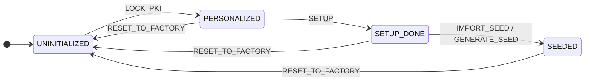

<!--
SPDX-FileCopyrightText: 2026 meowl.social contributors
SPDX-License-Identifier: AGPL-3.0-or-later
-->

# meowl-applet wire protocol

The sole normative specification for the meowl hardware-wallet applet. It defines the externally-observable contract a host SDK must implement: APDU framing, the Secure Channel, the lifecycle state machine, PIN/PUK, HD derivation, signing, and status words.

The applet sources under `applet/` and the test suite under `tests/` are the ultimate source of truth. Where this document and the code disagree, **the code wins** — fix the document, not the code. The reference host SDK in `tools/` is the canonical worked example of every flow below.

## Conventions

`‖` is concatenation; `[a..b)` is a half-open byte range; `x(n)` is an `n`-byte field. Every multi-byte integer is **big-endian** unless stated otherwise. All lengths are in bytes.

## 1. APDU framing

Every command uses `CLA = 0x80`; any other class byte returns `6E00`. There are two frames:

- **Outer frame** — a raw APDU sent directly to the card. Only the discovery, reset and Secure-Channel opcodes are reachable here.
- **Inner frame** — an APDU carried inside an `OPEN_SECURE_CHANNEL` envelope (§6). Every secret-touching opcode is inner-band and is reachable *only* through the Secure Channel.

An inner-band INS sent on the outer frame returns `6D00`, identical to an unallocated INS, so the outer surface never reveals which inner handlers exist.

## 2. Instruction set

`P1`/`P2` are `0x00` unless a command assigns them (noted below). "Gate" is the lifecycle precondition (§4); "PIN" marks commands that also require the session PIN flag (§7).

| INS | Name | Frame | Gate | PIN |
| --- | --- | --- | --- | --- |
| `0x01` | `GET_INFO` | outer | any | — |
| `0x02` | `GET_AUTHENTIKEY` | outer | any | — |
| `0x03` | `RESET_TO_FACTORY` | outer | any | — |
| `0x10` | `INIT_SECURE_CHANNEL` | outer | any | — |
| `0x11` | `OPEN_SECURE_CHANNEL` | outer | any | — |
| `0x20` | `SETUP` | inner | `PERSONALIZED` | — |
| `0x21` | `VERIFY_PIN` | inner | `≥ SETUP_DONE` | — |
| `0x22` | `CHANGE_PIN` | inner | `≥ SETUP_DONE` | — |
| `0x23` | `CHANGE_PUK` | inner | `≥ SETUP_DONE` | yes |
| `0x24` | `UNBLOCK_PIN` | inner | `≥ SETUP_DONE` | — |
| `0x30` | `EXPORT_PKI_PUBKEY` | inner | `UNINITIALIZED` | — |
| `0x31` | `SIGN_PKI_CSR` | inner | `UNINITIALIZED` | — |
| `0x32` | `IMPORT_PKI_CERT` | inner | `UNINITIALIZED` | — |
| `0x33` | `EXPORT_PKI_CERT` | inner | any | — |
| `0x34` | `LOCK_PKI` | inner | `UNINITIALIZED` | — |
| `0x40` | `IMPORT_SEED` | inner | `SETUP_DONE` | yes |
| `0x41` | `GENERATE_SEED` | inner | `SETUP_DONE` | yes |
| `0x42` | `EXPORT_XPUB` | inner | `SEEDED` | yes |
| `0x50` | `SIGN_ECDSA_K1` | inner | `SEEDED` | yes |
| `0x51` | `SIGN_SCHNORR_K1` | inner | `SEEDED` | yes |
| `0x52` | `SIGN_ED25519` | inner | `SEEDED` | yes |

## 3. Status words

Every response ends with a two-byte big-endian status word. Hosts MUST treat anything other than `9000` as a failure.

| SW | Meaning |
| --- | --- |
| `9000` | Success. The data field, if any, is the per-command payload. |
| `63Cn` | Wrong PIN or PUK; `n` retries remain. The counter that decremented is the one the command verifies (`UNBLOCK_PIN` decrements the PUK). |
| `6700` | Wrong length — the data field does not match the command's layout. Length-policy failures (PIN/PUK/seed bounds) land here and do **not** consume a retry. |
| `6982` | Session PIN flag required but not set; run `VERIFY_PIN` in this session and retry. |
| `6983` | PIN or PUK retry counter exhausted. A blocked PIN is recoverable via `UNBLOCK_PIN`; a blocked PUK is terminal. |
| `6985` | A non-lifecycle use-condition failed — e.g. `LOCK_PKI` with no staged certificate, a SLIP-10 index without the hardened bit, or a seed that fails validation. |
| `6A86` | Wrong `P1`/`P2`, or an in-band selector out of range — an unknown `IMPORT_PKI_CERT` `P1`, or an `EXPORT_XPUB` curve byte other than `0x00`/`0x01`. |
| `6D00` | INS not supported at this frame (an inner-band INS on the outer frame, or an unallocated INS). |
| `6E00` | `CLA` is not `0x80`. |
| `6FAn` | `RESET_TO_FACTORY` countdown — `n` further consecutive invocations are required; `n = 0` means the wipe has been performed (§4). |
| `6FB0` | Lifecycle FSM forbids this command in the current state. |
| `6FB1` | Inner-band command reached with no open Secure Channel; handshake and retry. |
| `6FB2` | Secure Channel cryptographic failure — handshake failure, replay, MAC mismatch, padding mismatch, or a non-increasing inbound IV. |
| `6FE0` | A required JavaCard feature is unavailable on this silicon (checked at install), or a native primitive returned a non-conformant result. |
| `6FE1` | Should-never-happen sentinel — the BIP-340 tagged hash reduced to zero mod `n` during Schnorr signing (probability ≈ 2⁻²⁵⁶); retry. |

## 4. Lifecycle

The applet is a four-state forward-only FSM. The `authentikey` (§5) is generated at install and survives every transition, including reset.



| State | Value | Meaning |
| --- | --- | --- |
| `UNINITIALIZED` | `0x00` | Fresh instance; only the authentikey exists. PKI personalisation runs here. |
| `PERSONALIZED` | `0x01` | Manufacturer certificate installed and locked. |
| `SETUP_DONE` | `0x02` | User PIN and PUK provisioned; no seed. |
| `SEEDED` | `0x03` | Master seed loaded; derivation and signing are enabled. |

Forward edges advance exactly one state; the only retrograde edge is reset. A command issued in the wrong state returns `6FB0`.

`RESET_TO_FACTORY` must be invoked **four consecutive times** with no other command in between (any other APDU rearms the counter). Each invocation returns `6FA3`, `6FA2`, `6FA1`, then `6FA0`; the fourth performs the wipe atomically — PIN/PUK, PKI certificate, master seed and lifecycle are cleared, the authentikey is kept — and the card returns to `UNINITIALIZED`.

## 5. Identity and discovery

The `authentikey` is a persistent secp256k1 keypair, generated once at install, never rotated, and preserved across reset. It anchors card identity and signs the Secure Channel handshake.

`GET_AUTHENTIKEY` returns the 33-byte compressed authentikey public key.

`GET_INFO` returns a TLV blob (single-byte tag, single-byte length, value) in this fixed order:

| Tag | Length | Value |
| --- | --- | --- |
| `0x01` | 2 | Protocol version (`0x0100`). |
| `0x02` | 2 | Applet version (`0x0001`). |
| `0x03` | 1 | Lifecycle state (§4). |
| `0x04` | 2 | Capability bitmask (below). |
| `0x05` | 33 | Compressed authentikey public key. |

The capability bitmask advertises the implemented feature set. The current build reports `0x01F7`:

| Bit | Mask | Capability |
| --- | --- | --- |
| 0 | `0x0001` | secp256k1 ECDSA signing |
| 1 | `0x0002` | secp256k1 BIP-340 Schnorr signing |
| 2 | `0x0004` | Ed25519 signing |
| 4 | `0x0010` | Secure Channel (AES-256-CBC + AES-CMAC-128) |
| 5 | `0x0020` | PKI personalisation |
| 6 | `0x0040` | `RESET_TO_FACTORY` |
| 7 | `0x0080` | BIP-32 secp256k1 derivation |
| 8 | `0x0100` | SLIP-10 Ed25519 derivation |

`GET_INFO` is intentionally unauthenticated so a host can identify the card before opening a channel.

## 6. Secure Channel

The Secure Channel gives confidentiality, integrity, card authentication and forward secrecy over a one-roundtrip ephemeral-ECDH handshake plus an authenticated record layer. Its cipher suite is secp256k1 ECDH (`ALG_EC_SVDP_DH_PLAIN_XY`), an AES-CMAC-128 KBKDF, AES-256-CBC with PKCS#5 padding, and a full 16-byte AES-CMAC-128 tag.

### 6.1 Handshake — `INIT_SECURE_CHANNEL` (`0x10`)

Inbound data is the host ephemeral public key, SEC1-uncompressed:

```text
client_eph_pub : 65   ; 0x04 ‖ x ‖ y on secp256k1
```

A wrong length returns `6700`; a non-`0x04` prefix or an off-curve point returns `6FB2` (the applet maps every exception out of the native ECDH to `6FB2` and never leaks the silicon exception type). The card tears down any prior session and the PIN flag, generates a fresh ephemeral keypair, then responds:

```text
card_eph_pub : 65            ; SEC1-uncompressed
sig_len      : 2             ; big-endian length of sig
sig          : sig_len (≤72) ; DER ECDSA-SHA-256 over (card_eph_pub ‖ client_eph_pub)
```

The host MUST verify `sig` against the authentikey from `GET_INFO` before deriving session keys, and SHOULD pin the authentikey on first use to reject counterfeit cards.

### 6.2 Key derivation

Both sides compute `shared = ECDH(eph_priv, peer_eph_pub)` and run an HKDF-shaped AES-CMAC KBKDF over its x-coordinate:

```text
salt      = client_eph_pub_x ‖ card_eph_pub_x          ; 64
ikm       = shared_x                                   ; 32
K_extract = SHA-256(salt)[0..16)                        ; 16-byte CMAC key
PRK       = AES-CMAC-128(K_extract, ikm)                ; 16
; Expand (RFC 5869 shape, CMAC PRF), T(0) = empty:
;   T(i) = AES-CMAC-128(PRK, T(i-1) ‖ info ‖ [i]) , i = 1..4
okm       = T(1) ‖ T(2) ‖ T(3) ‖ T(4)                   ; 64
            K_enc   = okm[ 0..32)   ; AES-256 encryption key
            K_mac   = okm[32..48)   ; AES-CMAC-128 MAC key
            IV_base = okm[48..64)   ; outbound IV mask
```

`info` is the 11 ASCII bytes `meowl-sc-v1` (no NUL). A future suite MUST use a fresh label.

### 6.3 Record layer — `OPEN_SECURE_CHANNEL` (`0x11`)

Inbound envelope (the outer header is `80 11 00 00 LC`):

```text
IV(16) ‖ ciphertext(N×16) ‖ MAC(16)
ciphertext = AES-256-CBC(K_enc, IV, inner_apdu ‖ pkcs5_pad)
MAC        = AES-CMAC-128(K_mac, [CLA INS P1 P2 LC] ‖ IV ‖ ciphertext)
```

The card processes it in this order: reject lengths below `48` with `6700`; reject `IV ≤ last_inbound_IV` with `6FB2`; verify the MAC with a constant-time comparison (`6FB2` on mismatch); commit the new `last_inbound_IV`; AES-decrypt and strip PKCS#5 padding (`6FB2` on a malformed pad); dispatch the inner APDU. MAC-then-decrypt ordering plus the constant-time compare close the padding-oracle surface. `IV` is a 16-byte big-endian counter the host MUST strictly increase on every envelope, including retries.

Outbound envelope, emitted whether or not the inner handler succeeded:

```text
IV(16) ‖ ciphertext(N×16) ‖ MAC(16)        ; then SW = 9000
IV  = IV_base XOR outbound_counter
MAC = AES-CMAC-128(K_mac, 0xFF ‖ IV ‖ ciphertext)
```

The `0xFF` direction tag prevents a card response from being replayed as a host command. If the inner handler throws, the inner status word is surfaced as the outer status word with an empty body, so the encrypted layer is invisible to a passive observer. An inbound MAC failure returns a bare `6FB2` with no envelope.

### 6.4 Session scope

`K_enc`, `K_mac`, `IV_base`, the replay counters and the PIN flag are session-scoped transient state. They are cleared on card deselect, on a fresh `INIT_SECURE_CHANNEL`, on a completed reset, and on any record-layer cryptographic failure. A host MUST therefore re-run `VERIFY_PIN` after any of those events.

## 7. PIN and PUK

The card holds one user PIN and one unblock PUK, each backed by a JavaCard `OwnerPIN` retry counter.

| Field | Min | Max | Retries |
| --- | --- | --- | --- |
| PIN | 4 | 16 | 3 |
| PUK | 8 | 32 | 5 |

A length outside policy returns `6700` and does **not** consume a retry — it is a host-side protocol error, not a guess. A wrong-but-well-formed value returns `63Cn`; an exhausted counter returns `6983`. `VERIFY_PIN` sets the session PIN flag (§6.4) on success.

Inner data layouts:

```text
SETUP        : pinLen(1) ‖ PIN ‖ pukLen(1) ‖ PUK     ; PERSONALIZED → SETUP_DONE
VERIFY_PIN   : PIN
CHANGE_PIN   : oldLen(1) ‖ oldPIN ‖ newLen(1) ‖ newPIN
CHANGE_PUK   : oldLen(1) ‖ oldPUK ‖ newLen(1) ‖ newPUK   ; requires PIN flag
UNBLOCK_PIN  : pukLen(1) ‖ PUK ‖ newPinLen(1) ‖ newPIN
```

`CHANGE_PIN` and `UNBLOCK_PIN` validate the **new** value's length policy *before* verifying the old secret, so a mistyped new PIN returns `6700` without consuming a retry of the old PIN or the scarce PUK. `UNBLOCK_PIN` is accepted only once the PIN counter has reached zero; calling it earlier returns `6985`.

## 8. PKI personalisation

Manufacturer personalisation runs in `UNINITIALIZED`. The host builds a CSR from the authentikey, obtains a certificate, imports it in chunks, then locks the card into `PERSONALIZED`.

```text
EXPORT_PKI_PUBKEY  : (no data)                 → compressed authentikey (33)
SIGN_PKI_CSR       : digest(32)                → DER ECDSA-SHA-256 over the digest (≤72)
IMPORT_PKI_CERT    : P1 selects the sub-step
                       INIT     (0x00) data = totalSize(2)
                       WRITE    (0x01) data = offset(2) ‖ chunk(≤200)
                       FINALIZE (0x02) data = (empty)
EXPORT_PKI_CERT    : offset(2) ‖ requestedLen(2)  → certTotalLen(2) ‖ window
LOCK_PKI           : (no data)                 ; requires a staged cert → PERSONALIZED
```

A certificate is at most 1024 bytes. `EXPORT_PKI_CERT` is allowed in any post-personalisation state so a host can verify the card before unlocking the PIN flow; its response leads with the total length so the host knows when to stop paging.

## 9. Seed and HD derivation

A seed is installed once in `SETUP_DONE`, advancing the card to `SEEDED`. Both seed commands require the PIN flag.

```text
IMPORT_SEED   : seedLen(1) ‖ seed         ; seedLen ∈ [16, 64]
GENERATE_SEED : (no data)                 → seed(64)   ; returned once, for backup
```

`GENERATE_SEED` returns the raw 64-byte seed exactly once so the host can render a backup; after that only public material ever leaves the card.

A derivation path is `depth(1) ‖ index(4)×depth`, each index big-endian; an index with the high bit set is hardened. `depth` is at most 8. SLIP-10 (Ed25519) accepts **hardened indices only** — a non-hardened index returns `6985`.

```text
EXPORT_XPUB : curve(1) ‖ depth(1) ‖ path(4×depth)
                curve 0x00 secp256k1 (BIP-32) → compressed_pubkey(33) ‖ chain_code(32)
                curve 0x01 Ed25519   (SLIP-10) → pubkey_LE(32)        ‖ chain_code(32)
```

A curve byte other than `0x00`/`0x01` returns `6A86`.

## 10. Signing

All signers take a derivation path and produce a fixed-length signature. ECDSA and Schnorr sign a host-supplied 32-byte digest; Ed25519 signs a raw message (RFC 8032 hashes it on-card).

```text
SIGN_ECDSA_K1   : depth(1) ‖ path(4×depth) ‖ digest(32)  → r(32) ‖ s(32)
SIGN_SCHNORR_K1 : depth(1) ‖ path(4×depth) ‖ digest(32)  → R(32) ‖ s(32)
SIGN_ED25519    : depth(1) ‖ path(4×depth) ‖ message(*)  → R(32) ‖ S(32)
```

- **ECDSA** (secp256k1) — `s` is normalised to the low half of the curve order (BIP-62 / EIP-2). The recovery byte, if a host needs one, is computed host-side.
- **Schnorr** (BIP-340) — `R` is the x-only nonce point. The nonce mixes on-card auxiliary randomness, so signatures over the same input differ between calls yet always verify.
- **Ed25519** (RFC 8032) — `R` is the compressed Edwards point, `S` the little-endian scalar. The nonce is derived from `SHA-512(prefix ‖ M)`, so signing is deterministic.
